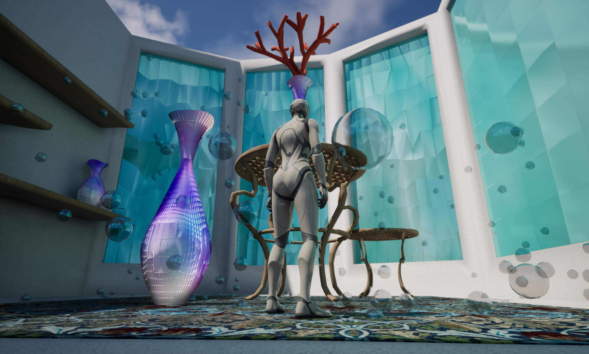

# Procedural_Room

An ocean-inspired, walkable room built around procedurally generated assets. The vases, glass windows, and drifting bubbles were modeled and simulated in Houdini, then brought into Unreal Engine for materials, lighting, and real-time rendering.

[View the full presentation (PDF)](images/WalkableRoom_Presentation.pdf)

## Procedural Features

**Vases**
- Vase silhouette driven by a ramp parameter, read in VEX with `chramp` to control the radius profile
- Sine-based displacement on point position (adjustable frequency and amplitude) for ruffled edges
- Jittered points to vary cell size and orientation
- Per-face extrusion for a scale-like surface
- Varied input parameters, offsets, and scale to generate many different vases from one network

**Chair and Table**
- Chair and table legs created using `curve` + `sweep`
- Lattice created using `copytopoints` and cylinder geometry 
  
**Glass windows**
- Grid geometry with noise on point position (`P`) for a stained-glass mosaic look
- Float noise on the color attribute (`Cd`) to vary the shade of blue across panes

**Bubbles**
- POP network simulation with POP force and POP drag for slow, drifting motion
- `copytopoints` to instance bubble geometry onto the simulated particles

## Materials

**Glass Material**
- Noise on the vertex color (`Cd`) attribute in Houdini, using float noise instead of vector noise to vary the shade of blue across panes
- In Unreal, the `M_glass` material reads the Vertex Color node into Base Color
- Exposed scalar parameters control Metallic and Roughness: lower roughness for a glossy look, higher metallic for a shiny look

**Bubble Material**
- Transparent material with a `Lerp` blending between input colors
- Fresnel drives the lerp alpha, so the color shifts with viewing angle for an iridescent look

**Carpet Material**
- Image texture for the base pattern
- Noise applied to the normals for a soft, "fuzzy" look

## Design System

- **Color:** iridescent blues, purples, and pinks, with orange/red coral as pops of color. Nothing leans too green or yellow.
- **Pattern:** repetition across windows, vases, the table and chair, and the rug texture
- **Everything else simple:** white and beige surroundings so the patterns stand out, with light texture on the walls
- **Inspiration:** stained glass for whimsy, and modern beach houses for the overall palette

## Built With

- **Houdini**: procedural modeling, VEX, POP simulation
- **Unreal Engine**: materials, lighting, real-time rendering

## Pipeline

1. Built the vases, windows, and bubble simulation as procedural networks in Houdini
2. Exported the geometry (FBX) and simulation (Alembic) to Unreal
3. Set up the `M_glass` material using the exported vertex color
4. Assembled and lit the room in Unreal, with a walkable character

# Demo

https://github.com/user-attachments/assets/9f837e96-298a-4696-bb07-aeff9db522e9

